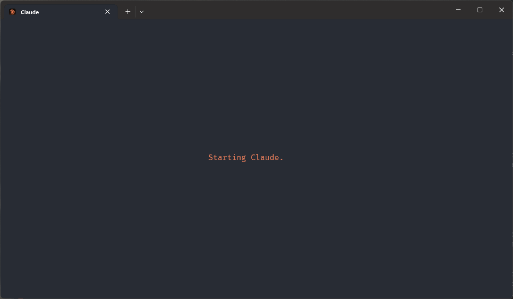
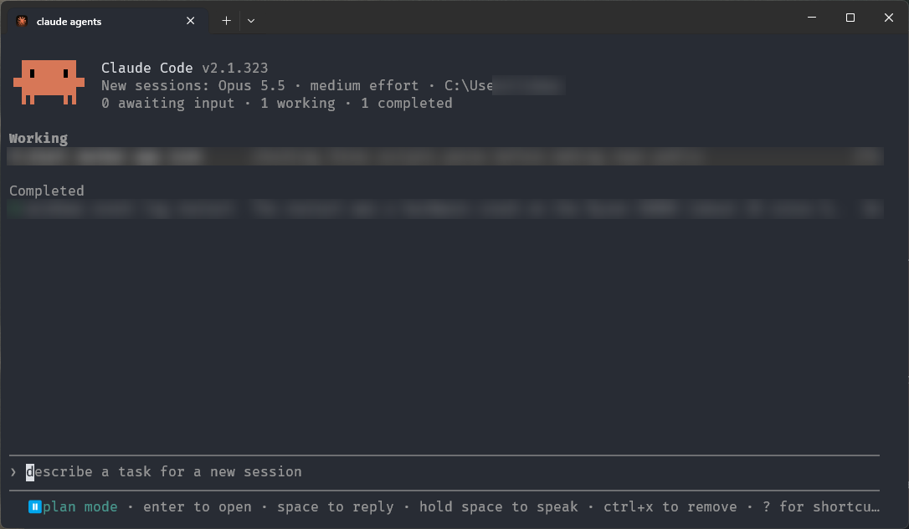
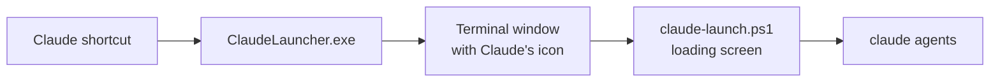

# Claude Launcher

[](https://github.com/lucaslobasso/claude-launcher/actions/workflows/ci.yml)
[](https://github.com/lucaslobasso/claude-launcher/releases)
[](LICENSE)
[](#requirements)

<p align="center">
  
</p>

A one-click **Claude** shortcut for Windows that opens [Claude Code](https://code.claude.com/docs) in Windows Terminal, as if it were its own app:

- **Its own taskbar button and icon.** No Windows Terminal icon, and no Terminal button flashing up before the Claude one.
- **The full Windows Terminal look.** It runs in your real Windows Terminal with your font, theme, tabs and settings.
- **A loading screen** in Claude orange instead of a blank black window while Claude starts.
- **No trust prompt** every time you open it in your chosen folder.
- **Settings** for the folder it opens in and the Claude command it runs (the agent view by default).

> Unofficial community project, not affiliated with Anthropic.

**[Requirements](#requirements) · [Install](#install) · [Settings](#settings) · [How it looks](#how-it-looks) · [Update](#update) · [How it works](#how-it-works) · [Troubleshooting](#troubleshooting) · [Uninstall](#uninstall) · [Install the whole set](#install-the-whole-set)**

## Requirements

- Windows 10 or 11 with [Windows Terminal](https://aka.ms/terminal).
- [PowerShell 7](https://learn.microsoft.com/powershell/scripting/install/installing-powershell-on-windows) (`winget install Microsoft.PowerShell`). The scripts don't run in the older Windows PowerShell 5.1.
- [Claude Code](https://code.claude.com/docs). The native installer puts `claude.exe` in `%USERPROFILE%\.local\bin`; an npm install on your `PATH` works too.

The launcher exe is compiled on your machine from [`src/ClaudeLauncher.cs`](src/ClaudeLauncher.cs) with the C# compiler that ships with Windows. No binaries are downloaded.

## Install

**One line** (in PowerShell 7, no git needed):

```powershell
irm https://raw.githubusercontent.com/lucaslobasso/claude-launcher/main/bootstrap.ps1 | iex
```

It downloads the latest release's source to a temp folder, runs `install.ps1` from it, and deletes the temp folder. Read [`bootstrap.ps1`](bootstrap.ps1) first if you like; it's short.

**Or from a clone:**

```powershell
git clone https://github.com/lucaslobasso/claude-launcher
cd claude-launcher
pwsh -File install.ps1
```

Either way you get a **Claude** shortcut in the Start menu and on the Desktop. Open it, then right-click its taskbar button and pick **Pin to taskbar**.

## Settings

Settings live in `%USERPROFILE%\.claude\launcher\launcher.json`:

```json
{
  "folder": "%USERPROFILE%",
  "claudeArgs": "agents",
  "keepShellOpen": false
}
```

| Setting | What it does | Default |
|---|---|---|
| `folder` | Folder Claude opens in, pre-trusted so there's no trust prompt. Environment variables like `%USERPROFILE%` work. | your user folder |
| `claudeArgs` | Arguments passed to `claude`. `agents` opens the agent view; `""` starts a normal session. Use `"double quotes"` for an argument with spaces. | `agents` |
| `keepShellOpen` | `true`: when Claude exits, stay at a PowerShell prompt in that folder. `false`: close the tab. | `false` |

Edit the file and the next launch picks it up. Or re-run the installer with just what you want to change; everything else is kept:

```powershell
pwsh -File install.ps1 -Folder D:\code
pwsh -File install.ps1 -ClaudeArgs "agents --permission-mode plan"
pwsh -File install.ps1 -ClaudeArgs ""          # plain claude
pwsh -File install.ps1 -KeepShellOpen
```

Other installer options:

| Option | Does |
|---|---|
| `-ShortcutName "Claude Code"` | Name of the shortcuts, the Terminal profile and the taskbar button. Shortcuts under an old name are removed. |
| `-NoDesktopShortcut` | Only the Start menu shortcut. |
| `-InstallDir <path>` | Where the files go (default `%USERPROFILE%\.claude\launcher`). |

With the one-line install, pass options like this:

```powershell
& ([scriptblock]::Create((irm https://raw.githubusercontent.com/lucaslobasso/claude-launcher/main/bootstrap.ps1))) -Folder D:\code
```

For one run only, `claude-launch.ps1` takes `-Folder` and `-ClaudeArgs` too. `ClaudeLauncher.exe "<name>"` opens the launcher's Terminal profile with `<name>` on the taskbar button (the shortcuts pass `-ShortcutName`).

## How it looks

| | |
| --- | --- |
| **While Claude starts**: the loading screen | **Its own taskbar button** with the Claude icon |
|  |  |

**`claudeArgs: "agents"`** (default), a second later: Claude Code's agent view (session names blurred). With `claudeArgs: ""` it is a normal Claude Code session instead.



## Update

Run the one-line install again, or from a clone:

```powershell
pwsh -File install.ps1 -Update     # git pull, then reinstall; your settings are kept
```

The installer prints the installed version. See [CHANGELOG.md](CHANGELOG.md) for what changed.

## How it works



1. **Taskbar identity.** Windows groups taskbar buttons by a per-window *AppUserModelID*. Every Windows Terminal window normally shares Terminal's, so it shows Terminal's icon. `ClaudeLauncher.exe` starts a new Terminal window and listens for window-creation events (`SetWinEventHook`). The moment the new window exists, before it is shown, it gives the window its own ID and Claude's icon. The shortcut carries the same ID, so a pinned shortcut and the running window share one button. Then the exe exits.
2. **Terminal profile.** The installer adds a profile as a [Terminal fragment](https://learn.microsoft.com/windows/terminal/json-fragment-extensions), with a fixed GUID, so renaming it keeps it the same profile. Your own `settings.json` is only edited when it would override the profile: if `profiles.defaults` has `"elevate": true`, the launcher's entry gets `"elevate": false` (a backup is kept as `settings.json.bak-launcher`). It runs PowerShell 7 with `-NoProfile` (faster) and `-ExecutionPolicy Bypass`, so a strict policy can't block the launch script.
3. **Loading screen and launch.** [`claude-launch.ps1`](src/claude-launch.ps1) draws "Starting Claude" with animated dots in the middle of the window. It keeps going until Claude starts drawing (it notices the cursor move), with a 10-second limit. It also marks the configured folder as trusted in `~/.claude.json` (only if it isn't already), then runs `claude`.

Try the loading screen on its own without starting Claude:

```powershell
pwsh -File "$env:USERPROFILE\.claude\launcher\claude-launch.ps1" -Demo 5
```

## Troubleshooting

- **"Couldn't start Windows Terminal".** Install Windows Terminal, or turn its alias back on: Settings → Apps → Advanced app settings → App execution aliases → **Terminal**.
- **The installer says scripts are disabled, or "not digitally signed".** Run it with `pwsh -ExecutionPolicy Bypass -File install.ps1`. The installer unblocks its own files after that, and the launch itself always bypasses the policy.
- **"This script requires PowerShell 7".** You ran it from Windows PowerShell 5.1. Install PowerShell 7, then use `pwsh`.
- **A generic orange `>_` icon instead of Claude's.** `claude.exe` wasn't found when you installed (for example with an npm install, which has no `.exe`). The launcher works the same way. Re-run the installer after installing Claude Code natively to get Claude's icon.
- **The window opens as Administrator** (and shows Terminal's icon). The installer handles `"elevate": true` under `profiles.defaults`, so re-run `install.ps1`. If it still happens, check that the launcher's entry in `profiles.list` in your Terminal `settings.json` has `"elevate": false`.
- **Agent view hangs on "Opening…".** The Claude background service was probably started from an admin terminal, and a non-admin agent view can't talk to it. Close every Claude window and every admin terminal running Claude, then open the shortcut again.
- **Still the Terminal icon.** Re-pin from the running window (right-click its taskbar button, then Pin to taskbar). Pins made from an old shortcut can keep the old identity.
- **An empty taskbar button after uninstalling.** Unpin it, or restart Explorer.
- **Logs.** `ClaudeLauncher.log` (window labelling) and `spinner.log` (how long Claude took to start drawing) are in the install folder.

## Uninstall

```powershell
pwsh -File uninstall.ps1                # add -KeepSettings to keep launcher.json
```

With the one-line install there's no clone, so uninstall through the same script:

```powershell
& ([scriptblock]::Create((irm https://raw.githubusercontent.com/lucaslobasso/claude-launcher/main/bootstrap.ps1))) -Uninstall
```

This removes the shortcuts (Desktop, Start menu, and taskbar pins that point at the launcher), the Terminal profile and the installed files. It finds a custom `-InstallDir` by itself. Claude Code, its settings and the folder trust entry are not touched.

<!-- bundle:start (copied from claude-launcher/docs/bundle-section.md; edit it there and copy to all six READMEs) -->
## Install the whole set

This is one of six small tools that work well together. Each installs on its own, or get them all with one command:

| Tool | What it does | Runs on |
| --- | --- | --- |
| [Claude Launcher](https://github.com/lucaslobasso/claude-launcher) | One click from the taskbar or Start menu straight into Claude Code, with a Claude icon and a loading spinner | Windows |
| [Claude Taskbar](https://github.com/lucaslobasso/claude-taskbar) | Your Claude sessions and usage limits as dots and bars on the Windows taskbar | Windows |
| [boxed-messages](https://github.com/lucaslobasso/claude-boxed-messages) | Colored boxes around your prompts and Claude's replies | Any |
| [claude-statusline](https://github.com/lucaslobasso/claude-statusline) | A status line with model, context, branch, and usage only when it gets high | Any |
| [limit-revive](https://github.com/lucaslobasso/claude-sessions) | Resumes an unfinished session after the 5-hour or weekly limit resets (part of claude-sessions, with context-handoff and subagentify) | Any |
| [language-spinner](https://github.com/lucaslobasso/claude-language-spinner) | The "thinking" spinner shows words in a language you are learning | Any |

**Windows** (PowerShell 7):

```powershell
irm https://raw.githubusercontent.com/lucaslobasso/claude-launcher/main/bundle.ps1 | iex
```

To pick, pass options: `-Only statusline,limit-revive`, `-Skip launcher`, `-List` (show what is installed) or `-Uninstall`:

```powershell
& ([scriptblock]::Create((irm https://raw.githubusercontent.com/lucaslobasso/claude-launcher/main/bundle.ps1))) -Skip taskbar
```

**macOS and Linux:** the four plugins work everywhere. In a shell:

```sh
for p in boxed-messages statusline language-spinner; do
  claude plugin marketplace add "lucaslobasso/claude-$p"
  claude plugin install "$p@claude-$p" --scope user
done
claude plugin marketplace add lucaslobasso/claude-sessions
claude plugin install limit-revive@claude-sessions --scope user
```
<!-- bundle:end -->

## Contributing

```powershell
Invoke-Pester tests                      # Pester 5
Invoke-ScriptAnalyzer -Path . -Recurse -Settings PSScriptAnalyzerSettings.psd1
```

CI runs both and compiles the exe on every push. A tag `v*` publishes a GitHub release, which the one-line install picks up.

`bundle.ps1` (the whole-set installer) lives here too; its tests are in `tests/bundle.Tests.ps1`. The "Install the whole set" section is kept in [`docs/bundle-section.md`](docs/bundle-section.md) and copied into all six READMEs.

## License

[MIT](LICENSE) © Lucas Lobasso
