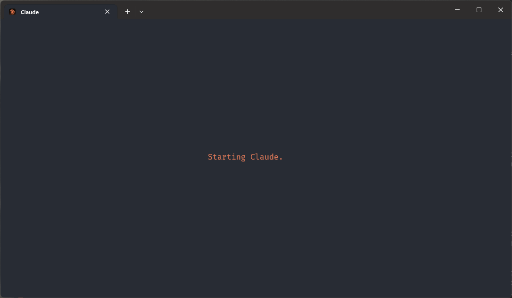
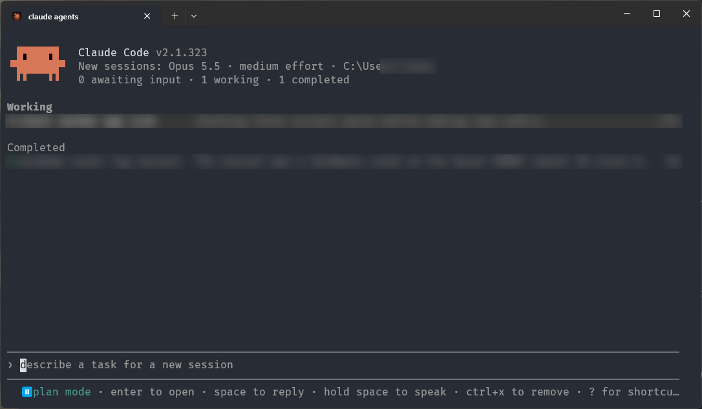
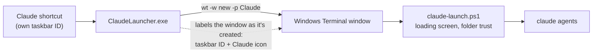

# Claude Launcher

A one-click **Claude** shortcut for Windows that opens [Claude Code](https://code.claude.com/docs) in Windows Terminal, as if it were its own app:

- **Its own taskbar button and icon.** No Windows Terminal icon, and no Terminal button flashing up before the Claude one.
- **The full Windows Terminal look.** It runs in your real Windows Terminal with your font, theme, tabs and settings.
- **A loading screen** in Claude orange instead of a blank black window while Claude starts.
- **No trust prompt** every time you open it in your user folder.
- **A setting for the folder** it opens in, and for the Claude command it runs (agent view by default).

<p align="center">
  
</p>

<p align="center">
  
  <br><sub>Claude gets its own taskbar button with the Claude icon, separate from your other terminals.</sub>
</p>

<p align="center">
  
  <br><sub>A second later: Claude Code's agent view (session names blurred).</sub>
</p>

> Unofficial. A small personal tool, not made by or affiliated with Anthropic.

## Requirements

- Windows 10 or 11 with [Windows Terminal](https://aka.ms/terminal)
- [PowerShell 7](https://learn.microsoft.com/powershell/scripting/install/installing-powershell-on-windows) (`winget install Microsoft.PowerShell`)
- [Claude Code](https://code.claude.com/docs) (native installer, so `claude.exe` is in `%USERPROFILE%\.local\bin`; otherwise it falls back to `claude` on your PATH)

Nothing is downloaded. The launcher exe is compiled on your machine from [`src/ClaudeLauncher.cs`](src/ClaudeLauncher.cs) with the C# compiler that ships with Windows.

## Install

```powershell
git clone https://github.com/lucaslobasso/claude-launcher
cd claude-launcher
pwsh -File install.ps1
```

This creates a **Claude** shortcut in the Start menu and on the Desktop. Open it, then right-click its taskbar button and pick **Pin to taskbar**.

## Settings

Settings live in `%USERPROFILE%\.claude\launcher\launcher.json`:

```json
{
  "folder": "%USERPROFILE%",
  "claudeArgs": "agents"
}
```

| Setting | What it does | Default |
|---|---|---|
| `folder` | Folder Claude opens in. Environment variables like `%USERPROFILE%` work. | your user folder |
| `claudeArgs` | Arguments passed to `claude`. `agents` opens the agent view; leave it empty for a normal session. | `agents` |

Edit the file and the next launch picks it up, or re-run the installer with just what you want to change (everything else is kept):

```powershell
pwsh -File install.ps1 -Folder D:\code
pwsh -File install.ps1 -ClaudeArgs "agents --permission-mode plan"
```

Other installer options: `-ShortcutName "Claude Code"` (shortcut name), `-NoDesktopShortcut`, `-InstallDir <path>`.

## How it works



1. **Taskbar identity.** Windows groups taskbar buttons by a per-window *AppUserModelID*. Every Windows Terminal window normally shares Terminal's, so it shows Terminal's icon. `ClaudeLauncher.exe` starts a new Terminal window and listens for window-creation events (`SetWinEventHook`). The moment the new window exists, before it is shown, it gives the window Claude's own ID and icon. The shortcut carries the same ID, so a pinned shortcut and the running window share one button. Then the exe exits.
2. **Terminal profile.** The installer adds a "Claude" profile as a [Terminal fragment](https://learn.microsoft.com/windows/terminal/json-fragment-extensions), so your own `settings.json` is never edited. It runs PowerShell 7 with `-NoProfile` to start faster.
3. **Loading screen and launch.** [`claude-launch.ps1`](src/claude-launch.ps1) draws "Starting Claude" with animated dots in the middle of the window. It keeps going until Claude starts drawing (it notices the cursor move), with a 10-second limit. It also marks the folder as trusted in `~/.claude.json`, because Claude Code doesn't remember trust for your user folder, and then runs `claude`.

Try the loading screen on its own without starting Claude:

```powershell
pwsh -File "$env:USERPROFILE\.claude\launcher\claude-launch.ps1" -Demo 5
```

## Troubleshooting

- **The window opens as Administrator.** If your Terminal settings have `"elevate": true` under `profiles.defaults`, it outranks the fragment. Add `"elevate": false` to the Claude entry in `profiles.list` in your Terminal `settings.json`.
- **Agent view hangs on "Opening…".** The Claude background service was probably started from an admin terminal. A non-admin agent view can't talk to it. Close every Claude window and admin terminal running Claude, then open the shortcut again.
- **Still see the Terminal icon.** Re-pin from the running window (right-click its taskbar button, then Pin to taskbar). Pins made from an old shortcut can keep the old identity.
- **Logs.** `ClaudeLauncher.log` (window labelling) and `spinner.log` (how long Claude took to start drawing) are in the install folder.

## Uninstall

```powershell
pwsh -File uninstall.ps1                # add -KeepSettings to keep launcher.json
```

This removes the shortcuts (Desktop, Start menu and taskbar pins that point at the launcher), the Terminal profile and the installed files. Claude Code and its settings are not touched.

## License

[MIT](LICENSE)
